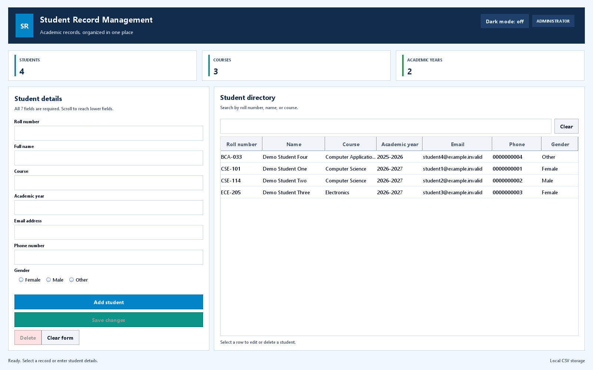
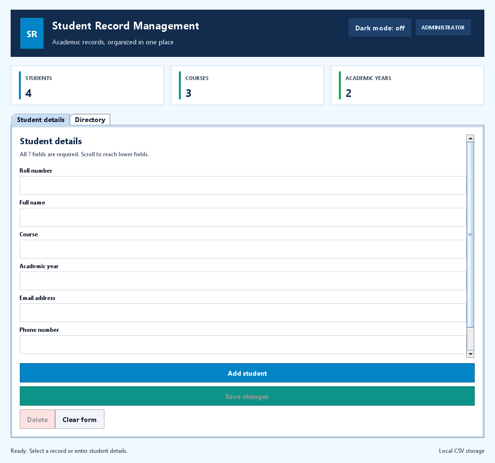
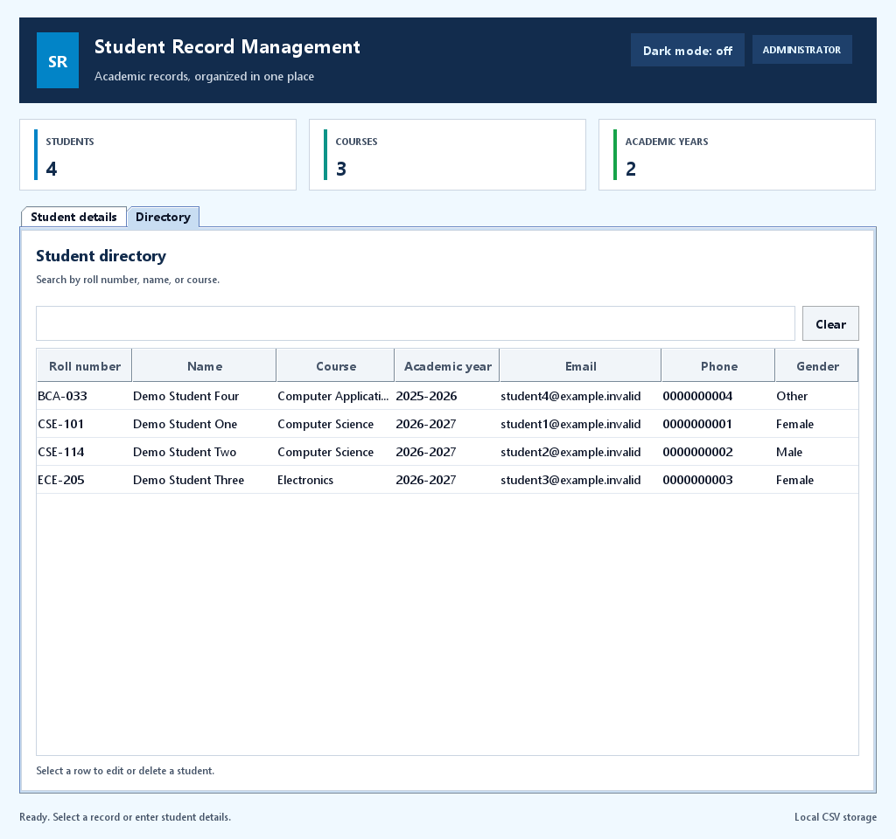
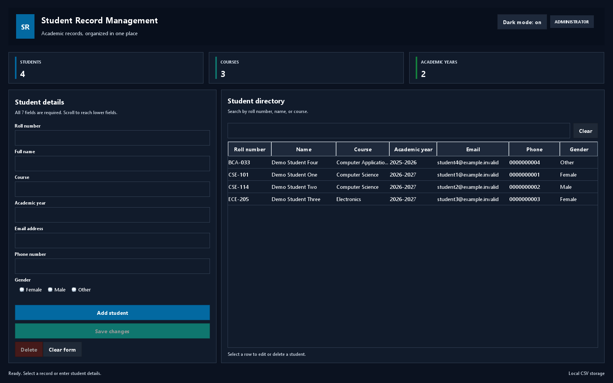

# Student Record Management System

A Java Swing desktop app for managing student records. Built as an Object-Oriented Programming mini-project for the Academy of Technology.



The app provides an administrator sign-in, a registration form, a searchable student directory, CSV persistence, and light and dark themes. The dashboard switches to tabs on narrower windows so the form and directory remain usable.

## Features

- Add, view, update, and delete student records.
- Search by roll number, student name, or course.
- View and sort records in a `JTable`.
- Validate required fields, academic-year format, email, phone, gender, and unique roll numbers.
- Save records to a local UTF-8 CSV file.
- Switch between light and dark themes.
- Use a responsive layout that changes to full-height tabs below 1180 pixels.

## Requirements

- JDK 17 or later, with `java` and `javac` available on `PATH`.
- No external Java libraries or database server are required.

## Run on Windows

From the project directory, double-click `run.bat` or run:

```bat
run.bat
```

The script compiles the project and starts the application.

### Demo sign-in

| Username | Password |
|---|---|
| `admin` | `admin123` |

These classroom demo credentials are hard-coded and are not suitable for production authentication.

## Student data

Each record contains a roll number, name, course, academic year, email address, phone number, and gender. All fields are required. Academic years use consecutive years in `YYYY-YYYY` format, such as `2026-2027`.

Records are stored in `data/students.csv`. The starter file contains only the column header, so the directory is empty until you add a student. The example rows in the screenshots are synthetic previews held in memory; they are not included in the data file. The CSV is ignored by Git so student data is not published with the source.

Each save writes a temporary file and replaces the previous CSV, preferring an atomic move when the file system supports it. To use a different location, pass the `student.data.path` Java system property before the main class.

## Build and verify

```bat
build.bat
verify.bat
render-screenshots.bat
```

`verify.bat` compiles with Java 17 compatibility and runs dependency-free acceptance checks for login, validation, theme switching, responsive layout, the Add button, CRUD operations, search, duplicate rejection, and CSV reload.

## Screenshots

| Wide dashboard | Compact student form | Compact directory | Dark mode |
|---|---|---|---|
|  |  |  |  |

The images are rendered from the application's Swing panels with synthetic sample data. They do not contain actual student records.

## Project layout

```text
src/main/java/       Application, model, service, CSV repository, and Swing UI
src/test/java/       Acceptance checks and screenshot renderer
data/                Local CSV data file
docs/                Technical report and data flow diagram
screenshots/         UI screenshots used in the report
```

See [the technical report](docs/TECHNICAL_REPORT.md) for the problem statement, objectives, design, data flow, Swing components, persistence, verification results, and screenshots.
