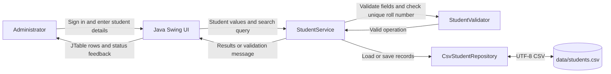
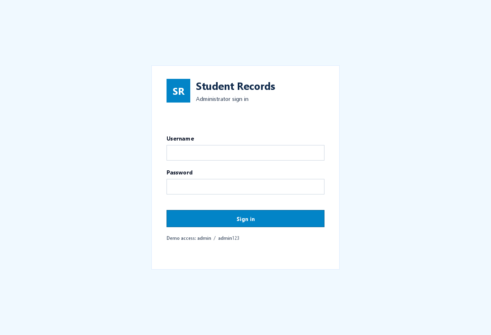
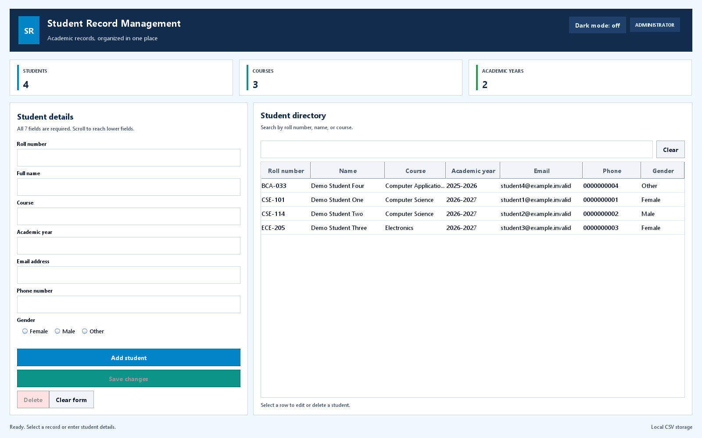
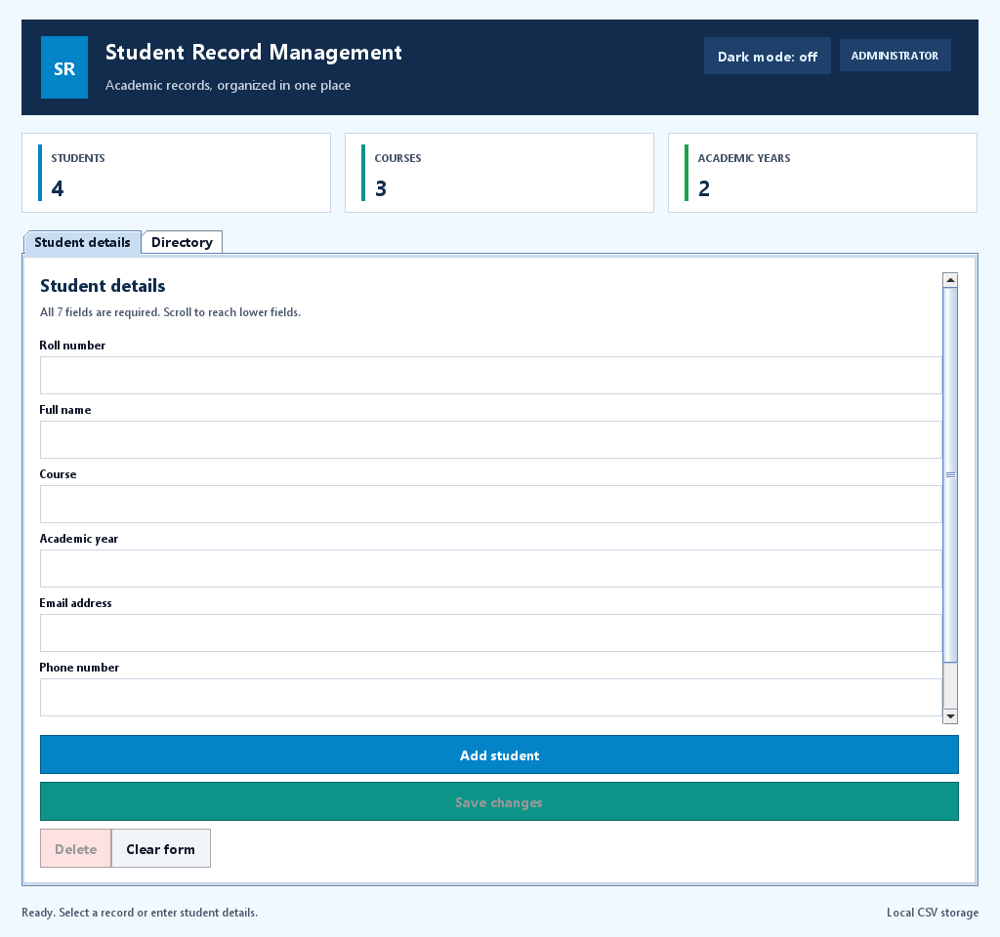
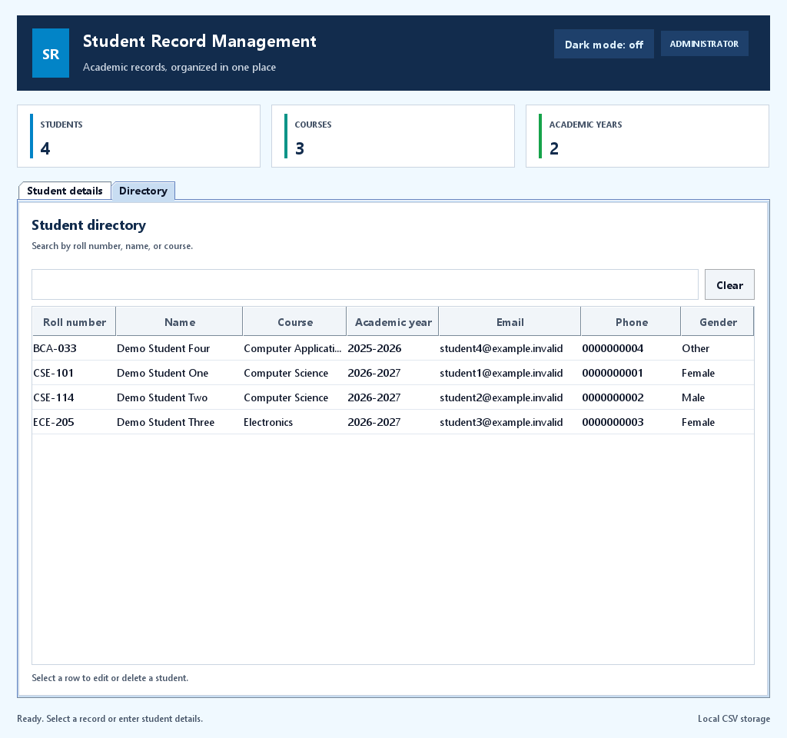
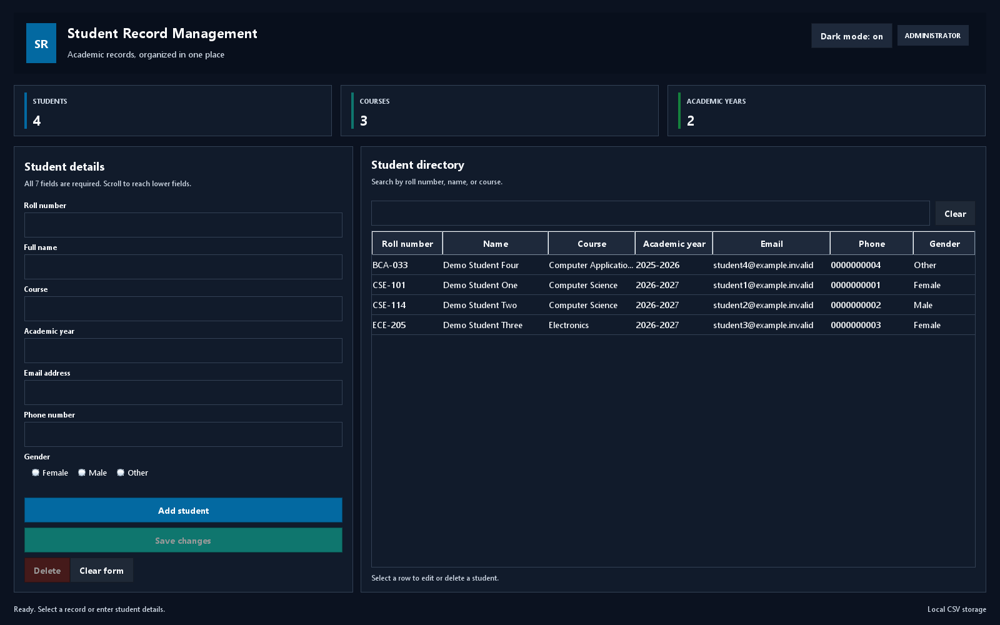

# Student Record Management System

**Assessment:** Design and Development of a Student Record Management System Using Java Swing  
**Course:** Object Oriented Programming, PCC-CS503  
**Programme:** B. Tech, CSE, Semester 5  
**Assessment type:** Design-based mini project

## 1. Introduction and problem definition

Colleges and coaching centres need accurate student details for academic and administrative work. Paper registers and disconnected spreadsheets make records harder to search and update, and can allow duplicate roll numbers or inconsistent contact information. This project provides a small desktop application for maintaining those records in one searchable table.

## 2. Objectives and scope

The application is designed to:

- provide an administrator sign-in screen;
- capture roll number, name, course, academic year, email, phone number, and gender;
- add, view, update, and delete student records;
- search records by roll number, student name, or course;
- reject incomplete, malformed, or duplicate records; and
- save records locally so they remain available after the application closes.

The project is a single-computer educational application. Its demo credentials and local CSV file are suitable for demonstrating Java Swing and file handling, but do not provide production account security, shared multi-user access, encryption, or database transaction support.

## 3. System design

The program separates the Swing interface, business rules, and persistence:

| Layer | Main classes | Responsibility |
|---|---|---|
| User interface | `LoginFrame`, `LoginPanel`, `DashboardFrame`, `DashboardPanel` | Sign-in, student form, searchable `JTable`, feedback, and delete confirmation |
| Model | `Student` | Immutable representation of the seven student fields |
| Service | `StudentService`, `StudentValidator` | Validation, case-insensitive roll-number uniqueness, CRUD, and search |
| Persistence | `StudentRepository`, `CsvStudentRepository` | Load and save UTF-8 CSV records with escaped fields and atomic file replacement |

### Data flow diagram



### Application flow

1. The application loads the configured CSV file. If it does not exist, the repository creates the folder and a header-only file.
2. The administrator signs in using the demonstration account.
3. The dashboard shows record counts, the student form, and the directory table.
4. The service validates form data and rejects duplicate roll numbers without changing stored records.
5. A successful add, update, or delete saves the updated collection before refreshing the table.

## 4. Swing components used

The sign-in and management screens use `JFrame` and `JPanel` for windows and layout; `JLabel` for titles, field labels, counts, and feedback; `JTextField` and `JPasswordField` for entry; `JRadioButton` and `ButtonGroup` for gender selection; and `JButton` for sign-in, add, save, clear, and delete actions. Student rows are displayed using `JTable` with a non-editable `AbstractTableModel`, inside `JScrollPane`. `JSplitPane` separates the form from the directory. `JOptionPane` asks for confirmation before deleting a record.

The layout keeps labels visible beside inputs, places feedback next to the form, supports standard keyboard focus and Enter-to-submit on sign-in, and uses a high-contrast blue, navy, and light-canvas palette. The dashboard switches to full-height Student details and Directory tabs below 1180 pixels and scrolls the form vertically when its visible area is short. A header control rebuilds the dashboard with the selected light or dark semantic palette while keeping the same `StudentService` and stored records.

## 5. CRUD, search, and validation

- **Create:** validates all seven fields, checks roll-number uniqueness without case sensitivity, then persists the record.
- **Read:** loads records when the application starts and displays them in a sortable table.
- **Update:** selecting a row copies its values into the form; saving replaces that record and persists the change.
- **Delete:** selecting a row enables the delete action; a confirmation dialog precedes removal.
- **Search:** filters immediately as the administrator types, matching roll number, name, or course without case sensitivity.

Validation requires all fields. Roll numbers use up to 20 letters, digits, `/`, `_`, or `-`; names allow letters and common punctuation; course names are limited to 80 characters; academic years must be consecutive years in `YYYY-YYYY` format; emails must have a valid address shape; phone numbers allow 7-15 digits with an optional `+`, spaces, hyphens, and parentheses; gender must be one of the displayed options. Validation errors are shown in the dashboard status area.

## 6. Data persistence

`CsvStudentRepository` stores records in UTF-8 CSV at `data/students.csv`. Each value is quoted and embedded quotes are doubled, so commas and quotation marks round-trip correctly. A save writes a sibling temporary file and replaces the original, preferring an atomic move where the file system supports it. The application can also use a different path through the `student.data.path` Java system property.

The starter CSV contains only the column header. Screenshots use synthetic example records held in memory; they are not inserted into the application's data file.

## 7. Verification results

The project's `verify.bat` was run with the installed JDK. It compiled the application and acceptance check, then reported:

```text
PASS: incorrect login rejected; demonstration login accepted
PASS: required fields, year, email, phone, and gender validation
PASS: dark mode switches to dark palette and back
PASS: dashboard switches to compact tabs on resize and Add student saves from the panel
PASS: add, list, update, delete, three search fields, duplicate guard, and CSV reload
PASS: 5 acceptance groups completed (login; validation; theme toggle; responsive panel/add action; CRUD/search/CSV persistence).
Acceptance checks completed.
```

The CSV check includes a course value with a comma and reloads it from disk. The screenshots below are rendered from the same Swing panels used by the application.

## 8. Major interfaces

### Administrator sign-in



### Student directory and registration form (wide window)



### Compact window layout: student details



### Compact window layout: directory



### Dark appearance



## 9. Conclusion

The project demonstrates a complete Java Swing record-management flow: sign-in, validated registration, table-based viewing, update and delete operations, multi-field search, and durable local storage. Its separation into model, service, UI, and repository classes makes the core rules easier to review and the storage layer easier to replace in a later database-backed version.

## Appendix: demonstration access

- Username: `admin`
- Password: `admin123`

These credentials are intentionally visible for classroom demonstration and are not secure authentication.
